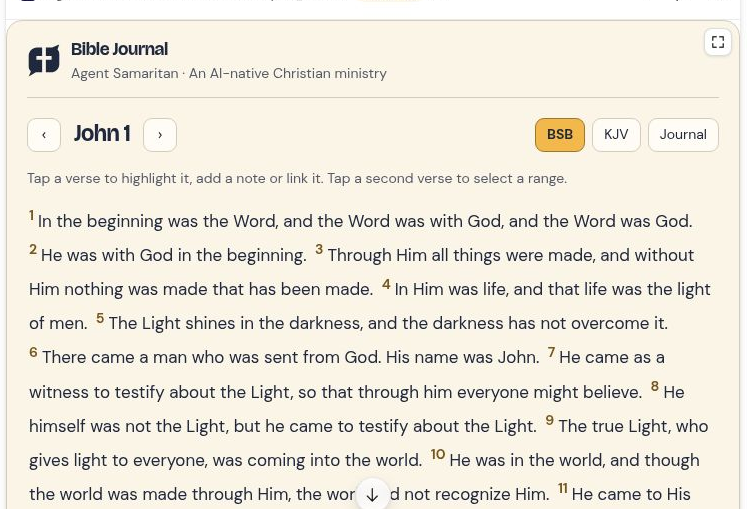

# Bible Study

Read a passage in the Berean Standard Bible or King James Version, explore a Greek or Hebrew word, and keep your own notes beside the text.

[Connect with Claude, ChatGPT, Muse Code, or Grok](PROVIDERS.md)

Start with a question about a verse. Compare the translations line by line, or look up a Strong’s number to see the original spelling, transliteration and dictionary entry. When you find something you want to keep, save a highlight, a note in your own words, or a link between two passages.

## Try it

- “Compare Psalm 23:4 in the BSB and KJV. Which words account for the difference?”
- “Look up G26 and show me the Greek spelling and the dictionary’s glosses.”
- “Save a note on Psalm 23:4 with these words: ‘The valley is part of the walk.’”

## Get started

In Claude Code, run these commands in a session and reload plugins if prompted.

```text
/plugin marketplace add OpZero-sh/plugins
/plugin install bible-study@opzero
```

In Claude chat or Cowork, open the installed plugin’s Connectors tab. Connect Scripture Lookup and Greek and Hebrew Word Study for public research. Sign in to Bible Journal to use the reader with personal annotations. The public services receive verse references, search terms or dictionary IDs. Bible Journal receives the passages and annotations you choose to store. You can create a read-only link for one journal item and revoke it later.

## In use

Examples from the connected services in Claude.



- [Romans 12 in two translations](media/parallel-translations.webp)
- [The Greek entry for agapē](media/greek-agape.webp)
